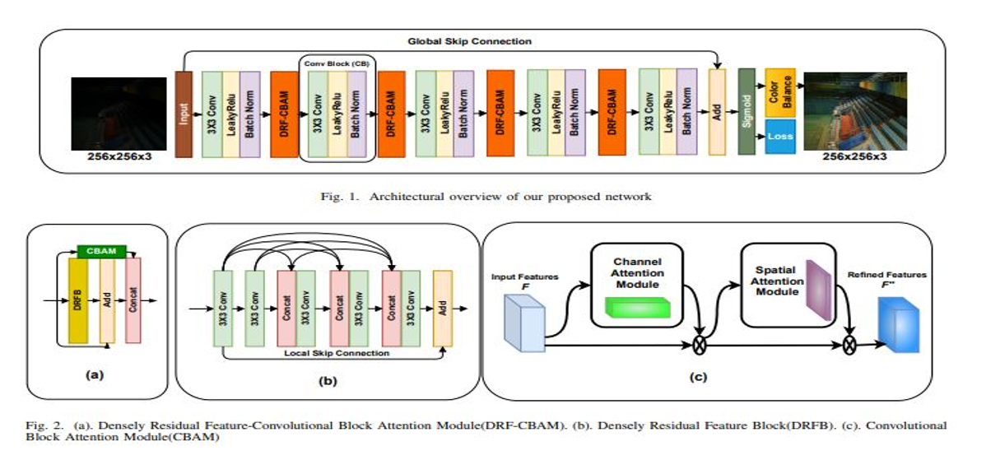
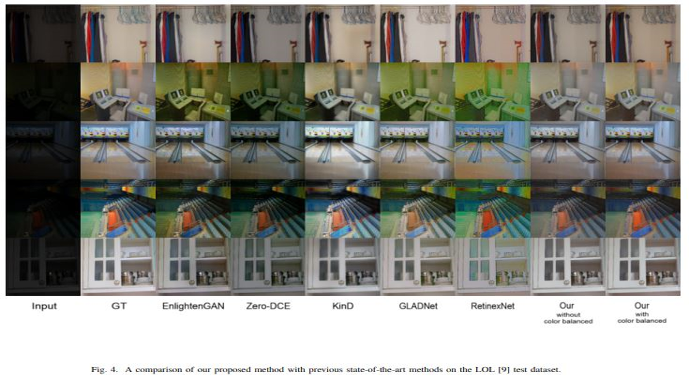
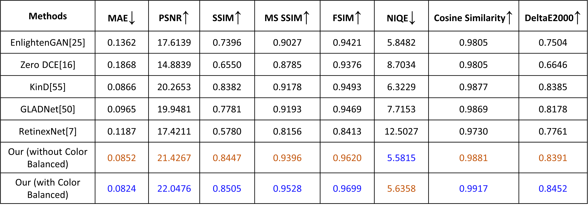

# Dense Residual Attention Network for Low-Light Image Enhancement

Code for our 2021 paper on low-light image enhancement. The network uses dense
residual blocks (DRB) with CBAM attention modules and is trained with a combined
MAE + SSIM + LAB loss on the LOL dataset.

## Architecture



## Requirements

- python 3
- Tensorflow 1.6.0
- Keras 2.2.0
- Opencv-python 3.4.2

## Usage

#### Testing

To test your own low-light images with our model, run

```
python predict.py -m <model folder> -i <input folder> -r <output folder>
```

By default, the code loads the model from "./saved_model" and saves results in
the "./results/" folder. Please read the code to see other parameter settings.

To evaluate on a paired test set (e.g. LOL eval15):

```
python evaluate.py -m <model folder> -d <test set root>
```

#### Training:

First, prepare your dataset with the following structure (low/high paired PNG
images of the same names):

```
data_root/
  low/
  high/
```

Then, you can just run through

```
python train.py -d <data_root> -e 250 -b 16
```

By default, the code saves the trained model in the "./saved_model/" folder.
Please read the code to see other parameter settings.

## Model

- DenseResidualAttentionCBAMLABLOSSDRBadd250epoch21_357634psnr0_8453417ssim_model
  (trained on the LOL dataset for 250 epochs; PSNR 21.3576, SSIM 0.845342 on
  the LOL eval15 set; saved in the TensorFlow SavedModel format, i.e. a folder
  containing saved_model.pb, variables/ and assets/)

## Results

Comparison with other methods on the LOL dataset:



Quantitative results:



## Bibtex

If you use this code for your research, please cite our paper.

@inproceedings{DRANet2023,
author = {Sami Ul Rehman and Ammar Hawbani and Xingfu Wang and Muhammad Hamza and Liang Zhao and Saeed H. Alsamhi and Majjed Al-Qatf},
title = {{DRA-Net: densely residual attention based low-light image enhancement}},
volume = {12705},
booktitle = {Fourteenth International Conference on Graphics and Image Processing (ICGIP 2022)},
editor = {Liang Xiao and Jianru Xue},
organization = {International Society for Optics and Photonics},
publisher = {SPIE},
pages = {1270522},
keywords = {Convolution Block Attention Module (CBAM), Attention Mechanism, Residual Skip Connection, Dense Skip Connection, Low-Light Image Enhancement, Color Balancing, Image Quality Assessment., Image Restoration},
year = {2023},
doi = {10.1117/12.2680479},
URL = {https://doi.org/10.1117/12.2680479}
}
